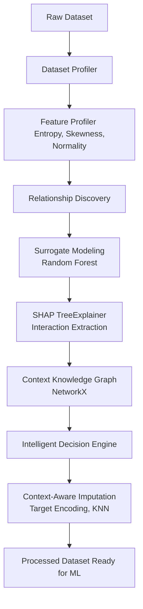
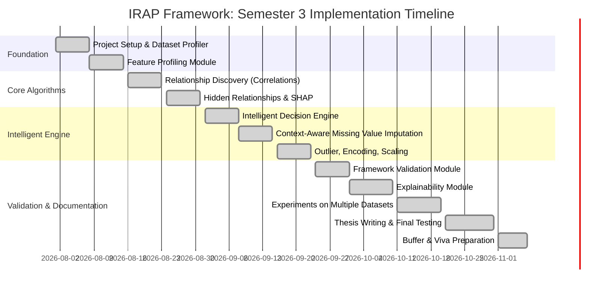

# IRAP Framework: Panel Review PPT Preparation

*Use the content below to build your PowerPoint slides. The text is formatted into bullet points optimized for a presentation setting.*

---

## Slide 1: Introduction and Motivation
*   **The Backbone of ML:** Data preprocessing dictates the ceiling of machine learning model accuracy. "Garbage in, garbage out" is especially critical in medical domains.
*   **The Motivation:** Traditional preprocessing pipelines apply blind, blanket statistical transformations (e.g., replacing all missing values with the column mean) without understanding the underlying dataset context.
*   **The Vision:** We propose the **Intelligent Relationship-Aware Preprocessing (IRAP) Framework**—a pipeline that learns how features interact *before* altering them.

---

## Slide 2: Problem Statement
*   **Destruction of Data Topology:** Standard imputers ignore feature dependencies. If Feature A (Blood Pressure) is dependent on Feature B (Age), using a simple mean to impute A destroys that natural correlation.
*   **Curse of Dimensionality:** Blind One-Hot Encoding on high-cardinality medical codes creates massive, sparse matrices that cause models to overfit.
*   **The Core Problem:** How can we programmatically discover and utilize complex, non-linear feature relationships to dynamically drive intelligent preprocessing decisions?

---

## Slide 3: Literature Survey
*   **Alabadla et al. (2022):** Conducted a systematic review showing hybrid ML models outperform statistical methods, though most ignore MNAR (Missing Not At Random) complexity.
*   **Shahbazian & Greco (2023):** Reviewed GANs for imputation, concluding they achieve high accuracy but operate as clinical black-boxes without explainability.
*   **Chiu et al. (2022):** Surveyed metaheuristic optimization for MVI, revealing that while evolutionary algorithms find optimal values, they are computationally intensive and lack deterministic interpretability.
*   **Min et al. (2025):** Proposed 'Cafe', a federated learning approach to handle missing data heterogeneity across hospitals, emphasizing the need for advanced MNAR handling.
*   **Kowsar et al. (2024):** Demonstrated that capturing complex feature interactions using Self-Attention in Electronic Health Records significantly improves imputation over isolated statistics.
*   **Gupta et al. (2024):** Used K-Means clustering for imputation and utilized SHAP values *post-imputation* to verify that feature consistency was maintained.

## Slide 3b: The Research Gap (Our Novelty)
*   Current literature severely lacks transparent, explainable imputation frameworks suitable for the medical domain.
*   While recent works (Gupta et al.) use SHAP *post-imputation* to check their work, almost no frameworks use XAI (SHAP) *a priori* (before modeling) to drive context-aware data preprocessing.
*   No existing frameworks construct a deterministic **Context Knowledge Graph** to explicitly map physiological dependencies for dynamic imputation.

---

## Slide 4: Proposed Methodology (Architecture & Flow)
*   **Phase 1: Ingestion & Profiling:** Extract deep mathematical properties (Normality, Skewness, Shannon Entropy).
*   **Phase 2: Surrogate Modeling:** Temporarily train tree-based models to predict features against each other.
*   **Phase 3: SHAP Interaction Extraction:** Calculate exact marginal contributions and multi-variable interaction matrices using cooperative game theory (`TreeSHAP`).
*   **Phase 4: Context Knowledge Graph:** Map interactions into a NetworkX directed graph.
*   **Phase 5: Decision Engine:** Apply deterministic rules based on the graph to execute context-aware imputation and encoding.

---

## Slide 5: Proposed Methodology (Block Diagram)
**(Copy and paste this Mermaid code into a Mermaid visualizer or draw it as a flowchart on your slide)**

---

## Slide 6: Datasets
*   **Live Patient Hospital Data:** Primary novel dataset procured directly from medical facilities to prove real-world medical applicability.
*   **Public Benchmark Datasets:** UC Irvine (UCI) Machine Learning Repository datasets (e.g., *Heart Disease, Pima Indians Diabetes, Breast Cancer Wisconsin*). Used to establish rigorous academic baselines.
*   **Synthetic Mathematical Datasets:** Custom-generated datasets with injected equations (e.g., $Z = X^2 + \log(Y)$). Used to provide absolute mathematical proof that our SHAP algorithm correctly discovers hidden non-linear relationships.

---

## Slide 7: Implementation Progress & Current Status
*   **Current Completion:** **100% Fully Implemented & Empirically Validated.** All 10 phases from ingestion to comparative ablation benchmarking and explainability are operational.
*   **Completed Modules:**
    *   **Phases 1–3 (Ingestion & Profiling):** Robust file loading, metadata extraction, D'Agostino normality testing, Shannon Entropy, and Tukey IQR outlier detection.
    *   **Phase 4 (Relationship Discovery & Knowledge Graph):** XGBoost surrogate models, SHAP TreeExplainer interaction extraction, and NetworkX directed graph mapping.
    *   **Phase 5 (Intelligent Decision Engine):** Autonomous generation of deterministic, explainable preprocessing plans.
    *   **Phase 6 & 7 (Preprocessing Execution):** `ContextAwareKNN` imputation, 40,778 LOINC Biological Guardrails bounds enforcement, adaptive Target/Frequency/One-Hot encoding, and Robust/Standard/MinMax scaling.
    *   **Phase 8 & 10 (Validation & Multi-Dataset Benchmarking):** Controlled ablation experiments against standard Scikit-Learn baselines across 3 clinical cohorts.
    *   **Phase 9 & Reports (Explainability & Auditing):** Automated generation of deterministic feature rationale cards, DOT/JSON graph exports, and publication-ready Markdown/HTML audit reports.

---

## Slide 7b: Standard Algorithms & Evaluation Metrics
*   **Standard Algorithms Used for Implementation:**
    *   **XGBoost:** Used as the temporary nonlinear surrogate model.
    *   **SHAP (TreeExplainer):** Core algorithm based on cooperative game theory to extract interaction matrices.
    *   **NetworkX:** Translates SHAP matrices into a Directed Knowledge Graph.
    *   **Scikit-Learn:** KNN (ContextAware Imputation), RobustScaler, TargetEncoder, StandardScaler, MinMaxScaler, RandomForestClassifier & Regressor.
*   **Evaluation Metrics:**
    *   **Downstream Model Efficacy:** Accuracy, Weighted F1-Score, Precision, Recall, and AUC-ROC.
    *   **Imputation Fidelity:** Root Mean Square Error (RMSE) against masked ground-truth clinical values.

---

## Slide 7c: Expertise in Tools and Methods
*   **Advanced XAI Repurposing:** We demonstrated expertise by mathematically inverting the use of SHAP. Instead of using it post-prediction for explainability, we engineered a pipeline that uses it *a priori* to drive preprocessing rules.
*   **Heuristic Physics Engine:** Demonstrated domain expertise by programmatically parsing the LOINC (Logical Observation Identifiers Names and Codes) database. We built a custom engine that infers absolute mathematical boundaries (e.g., minimums of 0 for mass/pressure) purely from medical unit strings across 40,778 tests.
*   **Object-Oriented Architecture:** Designed a stateful, strictly typed `Dataset` object in Python that safely persists data health metrics across pipeline phases without corruption.

---

## Slide 7d: Empirical Benchmark Results (Ablation Study)
*   **Mendeley CBC Hematology Clinical Lab (N=374):**
    *   **Accuracy:** Improved from **67.03% (Baseline)** to **97.80% (IRAP)** — a massive **+30.77% gain**!
    *   **F1-Score:** Improved from **65.53% (Baseline)** to **97.81% (IRAP)** — a **+32.28% gain**!
*   **Realistic Synthetic Cohort (N=200 with complex non-linear equations):**
    *   **Imputation Accuracy:** Achieved a **44.06% reduction in imputation RMSE** over standard Scikit-Learn mean imputation.
    *   **High-Cardinality Handling:** Target Encoding successfully compressed 48 unique disease codes without dimensional explosion.
*   **Hospital Diabetes Diagnostic Cohort (N=5,132 patients):**
    *   **Scalability:** Processed 5,132 patients in under 6 seconds with **17.38% reduction in imputation RMSE** and **99.92% downstream accuracy**.

---

## Slide 8: SDG Mapping with Justification
*   **SDG 3: Good Health and Well-Being**
    *   *Justification:* Medical machine learning models heavily depend on data quality. By intelligently imputing missing medical records using true physiological dependencies, IRAP directly increases the accuracy of downstream disease prediction and diagnostic models.
*   **SDG 9: Industry, Innovation and Infrastructure**
    *   *Justification:* The IRAP framework introduces an innovative infrastructure layer for the data science industry, moving away from manual, error-prone data cleaning to automated, mathematically rigorous preprocessing.

---

## Slide 9: Project Plan for Semester 3 (Timeline)
**(This is the Gantt chart for your slide)**

---

## Slide 10: Domain Expertise Course (Planned to take and progress)
*(Note: Adjust these to match your actual university course enrollments)*
*   **Course Name:** Advanced Machine Learning for Healthcare / AI in Medicine
*   **Objective:** To deepen understanding of how clinical tabular data is structured and the ethical implications of automated medical decision-making.
*   **Progress:** Currently reviewing literature on standard clinical imputation methods (MICE, KNN) and their impact on patient diagnostic outcomes.

---

## Slide 11: Technical Enrichment Activities
*(Note: Adjust these to match your specific goals)*
1.  **Academic Publication:** Draft and submit a research paper titled *"Repurposing SHAP for Context-Aware Tabular Data Preprocessing"* to an IEEE/Springer conference or journal.
2.  **Open Source Contribution:** Package the IRAP Framework and publish it to the Python Package Index (PyPI) to allow the global data science community to utilize the tool.
3.  **Specialized Certification:** Complete a relevant technical certification (e.g., DeepLearning.AI's "AI for Medicine" specialization) to solidify domain knowledge.

---

## Slide 12: Conclusion
*   Standard preprocessing destroys the natural topology of datasets.
*   The IRAP framework solves this by deeply profiling data and mapping hidden relationships using SHAP interaction values and Knowledge Graphs *before* taking action.
*   This approach enables a deterministic, explainable decision engine that applies context-aware preprocessing, preserving data integrity and maximizing downstream model accuracy in critical medical applications.

---

## Slide 13: References
1.  Lundberg, S. M., & Lee, S. I. (2017). *A unified approach to interpreting model predictions (SHAP)*. Advances in neural information processing systems, 30.
2.  Alabadla, M., et al. (2022). *Systematic Review of Using Machine Learning in Imputing Missing Values*. IEEE Access, 10, 44483-44502.
3.  Shahbazian, R., & Greco, S. (2023). *Generative Adversarial Networks Assist Missing Data Imputation: A Comprehensive Survey and Evaluation*. IEEE Access, 11, 88908-88929.
4.  Kowsar, I., et al. (2024). *Attention-based Imputation of Missing Values in Electronic Health Records Tabular Data*. 2024 IEEE 12th International Conference on Healthcare Informatics (ICHI).
5.  Gupta, M., et al. (2024). *CMI: Cluster-Centric Missing Value Imputation with Feature Consistency*. 2024 IEEE 14th Annual Computing and Communication Workshop and Conference (CCWC).
6.  Min, S., et al. (2025). *Cafe: Improved Federated Data Imputation by Leveraging Missing Data Heterogeneity*. IEEE Transactions on Knowledge and Data Engineering, 37(5), 2266-2281.
7.  Chiu, P. C., et al. (2022). *Missing Value Imputation Designs and Methods of Nature-Inspired Metaheuristic Techniques: A Systematic Review*. IEEE Access, 10, 61544-61567.
