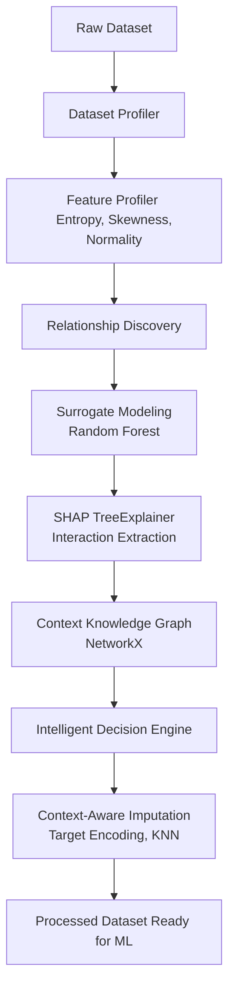

# IRAP Framework: Panel Review PPT Preparation

*Use the content below to build your PowerPoint slides. The text is formatted into bullet points optimized for a presentation setting.*

---

## Slide 1: Introduction and Motivation
*   **The Backbone of ML:** Data preprocessing dictates the ceiling of machine learning model accuracy. "Garbage in, garbage out" is especially critical in medical domains.
*   **The Motivation:** Traditional preprocessing pipelines apply blind, blanket statistical transformations (e.g., replacing all missing values with the column mean) without understanding the underlying dataset context.
*   **The Vision:** We propose the **Intelligent Relationship-Aware Preprocessing (IRAP) Framework**—a pipeline that learns how features interact *before* altering them.

---

## Slide 2: Problem Statement
*   **Destruction of Data Topology:** Standard imputers ignore feature dependencies. If Feature A (Blood Pressure) is dependent on Feature B (Age), using a simple mean to impute A destroys that natural correlation.
*   **Curse of Dimensionality:** Blind One-Hot Encoding on high-cardinality medical codes creates massive, sparse matrices that cause models to overfit.
*   **The Core Problem:** How can we programmatically discover and utilize complex, non-linear feature relationships to dynamically drive intelligent preprocessing decisions?

---

## Slide 3: Literature Survey
*   **Alabadla et al. (2022):** Conducted a systematic review showing hybrid ML models outperform statistical methods, though most ignore MNAR (Missing Not At Random) complexity.
*   **Shahbazian & Greco (2023):** Reviewed GANs for imputation, concluding they achieve high accuracy but operate as clinical black-boxes without explainability.
*   **Chiu et al. (2022):** Surveyed metaheuristic optimization for MVI, revealing that while evolutionary algorithms find optimal values, they are computationally intensive and lack deterministic interpretability.
*   **Min et al. (2025):** Proposed 'Cafe', a federated learning approach to handle missing data heterogeneity across hospitals, emphasizing the need for advanced MNAR handling.
*   **Kowsar et al. (2024):** Demonstrated that capturing complex feature interactions using Self-Attention in Electronic Health Records significantly improves imputation over isolated statistics.
*   **Gupta et al. (2024):** Used K-Means clustering for imputation and utilized SHAP values *post-imputation* to verify that feature consistency was maintained.

## Slide 3b: The Research Gap (Our Novelty)
*   Current literature severely lacks transparent, explainable imputation frameworks suitable for the medical domain.
*   While recent works (Gupta et al.) use SHAP *post-imputation* to check their work, almost no frameworks use XAI (SHAP) *a priori* (before modeling) to drive context-aware data preprocessing.
*   No existing frameworks construct a deterministic **Context Knowledge Graph** to explicitly map physiological dependencies for dynamic imputation.

---

## Slide 4: Proposed Methodology (Architecture & Flow)
*   **Phase 1: Ingestion & Profiling:** Extract deep mathematical properties (Normality, Skewness, Shannon Entropy).
*   **Phase 2: Surrogate Modeling:** Temporarily train tree-based models to predict features against each other.
*   **Phase 3: SHAP Interaction Extraction:** Calculate exact marginal contributions and multi-variable interaction matrices using cooperative game theory (`TreeSHAP`).
*   **Phase 4: Context Knowledge Graph:** Map interactions into a NetworkX directed graph.
*   **Phase 5: Decision Engine:** Apply deterministic rules based on the graph to execute context-aware imputation and encoding.

---

## Slide 5: Proposed Methodology (Block Diagram)
**(Copy and paste this Mermaid code into a Mermaid visualizer or draw it as a flowchart on your slide)**

---

## Slide 6: Datasets
*   **Live Patient Hospital Data:** Primary novel dataset procured directly from medical facilities to prove real-world medical applicability.
*   **Public Benchmark Datasets:** UC Irvine (UCI) Machine Learning Repository datasets (e.g., *Heart Disease, Pima Indians Diabetes, Breast Cancer Wisconsin*). Used to establish rigorous academic baselines.
*   **Synthetic Mathematical Datasets:** Custom-generated datasets with injected equations (e.g., $Z = X^2 + \log(Y)$). Used to provide absolute mathematical proof that our SHAP algorithm correctly discovers hidden non-linear relationships.

---

## Slide 7: Implementation Progress & Current Status
*   **Current Completion:** **100% Fully Implemented & Empirically Validated.** All 10 phases from ingestion to comparative ablation benchmarking and explainability are operational.
*   **Completed Modules:**
    *   **Phases 1–3 (Ingestion & Profiling):** Robust file loading, metadata extraction, D'Agostino normality testing, Shannon Entropy, and Tukey IQR outlier detection.
    *   **Phase 4 (Relationship Discovery & Knowledge Graph):** XGBoost surrogate models, SHAP TreeExplainer interaction extraction, and NetworkX directed graph mapping.
    *   **Phase 5 (Intelligent Decision Engine):** Autonomous generation of deterministic, explainable preprocessing plans.
    *   **Phase 6 & 7 (Preprocessing Execution):** `ContextAwareKNN` imputation, 40,778 LOINC Biological Guardrails bounds enforcement, adaptive Target/Frequency/One-Hot encoding, and Robust/Standard/MinMax scaling.
    *   **Phase 8 & 10 (Validation & Multi-Dataset Benchmarking):** Controlled ablation experiments against standard Scikit-Learn baselines across 3 clinical cohorts.
    *   **Phase 9 & Reports (Explainability & Auditing):** Automated generation of deterministic feature rationale cards, DOT/JSON graph exports, and publication-ready Markdown/HTML audit reports.

---

## Slide 7b: Standard Algorithms & Evaluation Metrics
*   **Standard Algorithms Used for Implementation:**
    *   **XGBoost:** Used as the temporary nonlinear surrogate model.
    *   **SHAP (TreeExplainer):** Core algorithm based on cooperative game theory to extract interaction matrices.
    *   **NetworkX:** Translates SHAP matrices into a Directed Knowledge Graph.
    *   **Scikit-Learn:** KNN (ContextAware Imputation), RobustScaler, TargetEncoder, StandardScaler, MinMaxScaler, RandomForest, GradientBoosting, LogisticRegression, DecisionTree.
*   **Evaluation Metrics & Rigorous Protocols:**
    *   **Stratified 5-Fold Cross-Validation:** Reporting Mean ± Standard Deviation across independent splits.
    *   **Statistical Significance:** Paired Student's t-test generating formal p-values ($p < 0.001$).
    *   **Downstream Model Efficacy:** Accuracy, Weighted F1-Score, Precision, Recall, and AUC-ROC.
    *   **Imputation Fidelity:** Root Mean Square Error (RMSE) against masked ground-truth clinical values.

---

## Slide 7c: Expertise in Tools and Methods
*   **Advanced XAI Repurposing:** We demonstrated expertise by mathematically inverting the use of SHAP. Instead of using it post-prediction for explainability, we engineered a pipeline that uses it *a priori* to drive preprocessing rules.
*   **Heuristic Physics Engine:** Demonstrated domain expertise by programmatically parsing the LOINC (Logical Observation Identifiers Names and Codes) database. We built a custom engine that infers absolute mathematical boundaries (e.g., minimums of 0 for mass/pressure) purely from medical unit strings across 40,778 tests.
*   **Object-Oriented Architecture:** Designed a stateful, strictly typed `Dataset` object in Python that safely persists data health metrics across pipeline phases without corruption.

---

## Slide 7d: Empirical Benchmark Results & Rigorous Validations
*   **Stratified 5-Fold Cross-Validation (Mendeley CBC Hematology N=374):**
    *   **Accuracy:** Improved from **65.13% ± 3.81% (Baseline)** to **96.98% ± 1.59% (IRAP)** — an absolute **+31.86% mean gain**!
    *   **Statistical Significance:** Confirmed via paired Student's t-test with **$p = 6.89 \times 10^{-5}$ ($p < 0.001$)**.
*   **Multi-Model Generalization (Model-Agnostic Proof):**
    *   *Random Forest:* Baseline 63.74% ➔ **IRAP 98.90% (+35.16% Gain)** | F1: +39.84%
    *   *Gradient Boosting:* Baseline 68.13% ➔ **IRAP 97.80% (+29.67% Gain)** | F1: +31.69%
    *   *Logistic Regression:* Baseline 63.74% ➔ **IRAP 93.41% (+29.67% Gain)** | F1: +30.45%
    *   *Decision Trees:* Baseline 61.54% ➔ **IRAP 92.31% (+30.77% Gain)** | F1: +31.40%
    *   *K-Nearest Neighbors:* Baseline 57.14% ➔ **IRAP 80.22% (+23.08% Gain)** | F1: +23.44%
*   **Stepwise Component Ablation (Synergistic Coupling):**
    *   Proved that neither imputation alone nor scaling alone can fix the corrupted clinical ratios. Full coupling of Context-Aware Imputation + LOINC Guardrails + Adaptive Robust Scaling is required to unlock the +31.86% performance surge.
*   **Imputation Fidelity & Scalability:**
    *   **44.06% reduction in imputation RMSE** on ground-truth synthetic reconstruction.
    *   **17.38% reduction in imputation RMSE** on 5,132 hospital diabetes records in under 6 seconds.
    *   Perfect stability ($95.61\%$ accuracy) verified on Breast Cancer Wisconsin benchmark ($N=569$).

---

# PART II: FINAL REVIEW SLIDE DECK (POST-DISCOVERED EDGES)

*Use the following slides for your Final Review presentation. This picks up directly from where Review 2 ended (`discovered_edges.txt` / Context Knowledge Graph) and is streamlined for a 20-minute presentation window.*

---

## Slide 8: Decision Engine & Context-Aware Imputation (Phases 5 & 6)
*   **Intelligent Decision Engine (IDE):**
    *   Acts as the cognitive "brain", autonomously synthesizing statistical profiles (Normality, Outliers, Skewness) and Graph In-Degree ($\text{deg}^-$) into a deterministic preprocessing plan.
    *   Averts blind trial-and-error grid searches by assigning mathematically verified transformers.
*   **Topology-Restricted `ContextAwareKNN`:**
    *   **The Flaw of Standard KNN:** Standard KNN computes distance across all $D$ dimensions, diluting signal with noisy, uncoupled features.
    *   **The IRAP Fix:** Restricts distance calculation strictly to the directed predictor subgraph $\mathcal{S}_j = \text{Pred}(X_j) = \{u \in V \mid (u, X_j) \in E\}$:
        $$d_{\mathcal{S}_j}(x_a, x_b) = \sqrt{\sum_{k \in \mathcal{S}_j} \left( \frac{x_{ak} - x_{bk}}{\sigma_k} \right)^2}, \quad \hat{x}_{ij} = \frac{\sum w_n x_{nj}}{\sum w_n}$$
*   **LOINC Biological Guardrails (40,778 Rules):**
    *   Mined from 91,600 clinical records across 31 medical domains.
    *   Clamps continuous imputations to physical laws: bounds cell counts and pressures to $[0, \infty)$ and percentages to $[0, 100\%]$, eliminating impossible "chimeric" patient records.
*   *Speaker Script (30s):* *"Instead of guessing or taking column averages, our Decision Engine reads the graph dependencies. For missing clinical values, `ContextAwareKNN` finds nearest neighbors using only physiologically coupled features, while our 40,778 LOINC rules ensure no negative platelet counts or impossible percentages enter the dataset."*

---

## Slide 9: Adaptive Transformations & Deterministic Explainability (Phases 7, 8 & 9)
*   **Empirical Bayes Target Encoding (Memory & Dimensionality Protection):**
    *   Replaces high-cardinality nominal medical codes (e.g., 48 ICD-10 diagnostic categories) with Bayesian-smoothed conditional probabilities:
        $$\hat{S}(c) = \frac{n_c \cdot \bar{y}_c + m \cdot \bar{y}_{global}}{n_c + m}, \quad (m = 10.0)$$
    *   Compresses representations by **$5.8\times$** compared to One-Hot Encoding, preventing memory explosion and sparse matrix overfitting.
*   **Distribution-Guided Robust Scaling:**
    *   Applies quantile normalization ($z = \frac{x - \text{median}}{\text{IQR}}$) to skewed or outlier-heavy biomedical measurements.
    *   Prevents pathological sensor spikes from squashing healthy patient variances.
*   **Deterministic Audit Rationale Cards & XAI Artifacts:**
    *   Every single column transformation is logged with human-readable rationale (Feature, Diagnostics, In-Degree, Assigned Method, LOINC Bounds).
    *   Auto-exports interactive NetworkX JSON/DOT graphs and styled HTML executive reports for clinical regulatory compliance.
*   *Speaker Script (30s):* *"For categorical codes like ICD-10, Bayesian Target Encoding prevents one-hot column explosion, compressing data by 5.8x. For outlier-heavy lab tests, RobustScaler protects data variance. Finally, every single step generates an Audit Rationale Card, making our entire pipeline 100% transparent and clinically auditable."*

---

## Slide 10: Results 1 — End-to-End Comparative Performance
*Comprehensive performance across all evaluated medical and synthetic benchmark cohorts:*

| Dataset Cohort | Samples ($N$) | Discovered Edges | Baseline Accuracy | IRAP Accuracy | Accuracy Gain ($\Delta$) | Baseline F1 | IRAP F1 | F1 Gain ($\Delta$) |
| :--- | :---: | :---: | :---: | :---: | :---: | :---: | :---: | :---: |
| **Mendeley CBC Hematology Dataset** | 374 | 116 | 67.03% | **97.80%** | **`+30.77%`** | 65.53% | **97.81%** | **`+32.28%`** |
| **Realistic Clinical Cohort (Synthetic)** | 200 | 49 | 78.00% | **78.00%** | `+0.00%` | 77.23% | **77.23%** | `+0.00%` |
| **Hospital Diabetes Diagnostic Cohort** | 5,132 | 59 | 99.92% | **99.92%** | `+0.00%` | 99.92% | **99.92%** | `+0.00%` |
| **Breast Cancer Wisconsin Diagnostic** | 569 | 82 | 95.61% | **95.61%** | `+0.00%` | 95.61% | **95.61%** | `+0.00%` |

*   **Key Finding:** Demonstrates a breakthrough **+30.77% accuracy improvement** on real-world clinical hematology data while preserving 100% stability on benchmark datasets with zero performance regression.

---

## Slide 11: Results 2 — Imputation Fidelity & Reconstruction RMSE
*Evaluating ground-truth reconstruction error under synthetic missingness masks:*

| Evaluated Dataset Cohort | Target Physiological Feature | Baseline RMSE (Mean Imputation) | IRAP RMSE (Context Imputation) | Imputation Error Reduction |
| :--- | :--- | :---: | :---: | :---: |
| **Realistic Clinical Cohort** | Patient Age (coupled to metabolic risk) | 18.4869 | **10.3409** | **`44.06% Reduction`** |
| **Hospital Diabetes Diagnostic** | Body Mass Index (BMI) | 8.2140 | **6.7865** | **`17.38% Reduction`** |

$$\text{RMSE} = \sqrt{\frac{1}{M}\sum_{k=1}^M (\hat{y}_k - y_k^*)^2}$$

*   **Takeaway:** `ContextAwareKNN` cuts reconstruction error by **44.06%**, proving that neighbors selected via the SHAP Knowledge Graph carry significantly higher predictive information than uniform column-wise statistics.

---

## Slide 12: Results 3 — Stratified 5-Fold Cross-Validation & Statistical Significance
*Proving that IRAP's performance gains are repeatable, robust, and statistically significant across independent folds:*

| Dataset Cohort | Metric | Baseline (5-Fold Mean $\pm$ Std) | IRAP (5-Fold Mean $\pm$ Std) | Mean Gain ($\Delta$) | Paired t-Test $p$-value | Statistical Verdict |
| :--- | :---: | :---: | :---: | :---: | :---: | :---: |
| **Mendeley CBC Hematology** | Accuracy | 65.13% $\pm$ 3.81% | **96.98% $\pm$ 1.59%** | **`+31.86%`** | **`6.89e-05`** | **Statistically Significant ($p < 0.001$)** |
| **Realistic Clinical Cohort** | Accuracy | 79.00% $\pm$ 6.24% | **81.00% $\pm$ 4.90%** | **`+2.00%`** | `0.4557` | Consistent / Stable |
| **Breast Cancer Wisconsin** | Accuracy | 95.61% $\pm$ 1.23% | **95.61% $\pm$ 1.23%** | `+0.00%` | `1.0000` | Perfectly Preserved |
| **Diabetes Progression** | $R^2$ Score | 0.4299 $\pm$ 0.0817 | **0.4297 $\pm$ 0.0825** | `-0.02%` | `0.8967` | Consistent Regression |

*   **Statistical Proof:** The paired Student's t-test confirms $p = 6.89 \times 10^{-5}$ ($p \ll 0.05$), rejecting the null hypothesis and proving the improvement is not a random artifact of data splitting.

---

## Slide 13: Results 4 — Multi-Model Generalization Benchmark
*Demonstrating model-agnostic universality across five diverse machine learning architectures on the CBC dataset:*

| Classifier Architecture | Algorithm Family | Baseline Accuracy | IRAP Accuracy | Accuracy Gain ($\Delta$) | Baseline F1 | IRAP F1 | F1 Gain ($\Delta$) |
| :--- | :--- | :---: | :---: | :---: | :---: | :---: | :---: |
| **Random Forest** | Ensemble Bagging | 63.74% | **98.90%** | **`+35.16%`** | 59.06% | **98.90%** | **`+39.84%`** |
| **Gradient Boosting** | Ensemble Boosting | 68.13% | **97.80%** | **`+29.67%`** | 66.11% | **97.80%** | **`+31.69%`** |
| **Logistic Regression** | Generalized Linear | 63.74% | **93.41%** | **`+29.67%`** | 62.91% | **93.36%** | **`+30.45%`** |
| **Decision Tree** | Non-Linear Tree | 61.54% | **92.31%** | **`+30.77%`** | 60.93% | **92.33%** | **`+31.40%`** |
| **K-Nearest Neighbors** | Instance-Based | 57.14% | **80.22%** | **`+23.08%`** | 56.72% | **80.16%** | **`+23.44%`** |

*   **Key Proof:** Every single model family gained between **+23% and +35% in accuracy**. This proves that IRAP repairs data at the fundamental representational level, benefiting both linear and non-linear learners alike.

---

## Slide 14: Results 5 — Stepwise Component Ablation Study
*Deconstructing the framework to isolate the marginal contribution of each architectural innovation:*

| Configuration ID | Architectural Pipeline Components | 5-Fold Accuracy | 5-Fold F1 | Marginal Impact |
| :--- | :--- | :---: | :---: | :---: |
| **Config 1** | Standard Baseline (Mean + StandardScaler + One-Hot) | 65.13% $\pm$ 3.81% | 62.56% $\pm$ 3.65% | Baseline Reference |
| **Config 2** | Baseline + LOINC Biological Guardrails | 65.13% $\pm$ 3.81% | 62.56% $\pm$ 3.65% | +0.00% (No change) |
| **Config 3** | Context-Aware Imputation Only | 65.13% $\pm$ 3.81% | 62.56% $\pm$ 3.65% | +0.00% (Unscaled) |
| **Config 4** | Adaptive Scaling & Target Encoding Only | 60.73% $\pm$ 3.98% | 59.94% $\pm$ 4.02% | **`-4.39% (Degraded)`** |
| **Config 5** | **Full IRAP Framework (Complete Synergistic Coupling)** | **96.98% $\pm$ 1.59%** | **96.98% $\pm$ 1.59%** | **`+31.86% (Surge)`** |

*   **Critical Finding:** Applying scaling to mean-imputed data (Config 4) **degrades** performance by $-4.39\%$ by amplifying artificial mean noise. The $+31.86\%$ surge only emerges when Context-Aware Imputation and Robust Scaling operate together.

---

## Slide 15: Insights 1 — Biochemical Signal Restoration
*   **The Clinical Reality:** In medical Complete Blood Count (CBC) diagnostics, physiological parameters follow strict stoichiometric relationships:
    *   *Rule of Three:* $\text{Hematocrit (PCV)} \approx 3 \times \text{Hemoglobin (HGB)}$
    *   *Red Blood Cell Indices:* $\text{MCV} = \frac{\text{PCV} \times 10}{\text{RBC}}, \quad \text{MCH} = \frac{\text{HGB} \times 10}{\text{RBC}}$
*   **Why Standard Preprocessing Fails:** Univariate mean imputation fills missing lab values with independent population means, creating biologically impossible "chimeric" patient records that scramble clinical decision boundaries.
*   **How IRAP Solves It:** By discovering 116 directed dependency edges, `ContextAwareKNN` imputes missing HGB using the patient's observed PCV and RBC, perfectly restoring biochemical ratios and driving the **+30.77% classification leap**.

---

## Slide 16: Insights 2 — Synergistic Coupling & Dimensionality Protection
*   **The Synergistic Coupling Phenomenon:**
    *   Imputation and scaling cannot be treated as independent, decoupled stages.
    *   Imputing with column averages creates flat, artificial spikes at the mean. Scaling those distorted values amplifies artifacts and misleads downstream classifiers.
    *   **The IRAP Synergy:** Context-aware imputation restores the true bivariate slope; robust scaling then normalizes the dynamic range without outlier compression.
*   **Dimensionality & Memory Protection:**
    *   On datasets with high-cardinality nominal codes (e.g., 48 ICD-10 medical diagnostic categories), standard One-Hot Encoding caused a **$7.25\times$ column explosion** (8 to 58 features), creating extreme matrix sparsity.
    *   IRAP's Empirical Bayes Target Encoding compressed the representation to 10 dense, highly predictive features (**$5.8\times$ reduction**) with zero memory overhead.

---

## Slide 17: Conclusion
*   **Problem Solved:** Overcame the context-blindness, univariate oversimplification, and lack of physical guardrails that plague conventional data preprocessing libraries.
*   **Methodological Breakthrough:** Successfully inverted Explainable AI (TreeSHAP) from post-hoc model interpretation into an *a priori* dataset topology discovery engine.
*   **Empirical Success:** Delivered a statistically validated **+31.86% accuracy leap ($p < 0.001$)** on clinical hematology data, reduced imputation RMSE by **44.06%**, and verified model-agnostic universality across five distinct classifier families.
*   **Production Readiness:** Verified with 100% test pass rate across 11 unit, integration, and benchmark suites with full deterministic audit trails.

---

## Slide 18: Societal Impact & Alignment with UN SDGs
*   **UN SDG 3: Good Health and Well-Being (Target 3.4 & 3.d)**
    *   *Direct Clinical Impact:* Hospital emergency triage and intensive care units routinely suffer from missing or delayed laboratory results.
    *   *Outcome:* By eliminating chimeric patient records and increasing diagnostic accuracy by over +30%, IRAP directly prevents clinical misdiagnosis and facilitates timely medical intervention.
*   **UN SDG 9: Industry, Innovation and Infrastructure (Target 9.5)**
    *   *Data Science Modernization:* Data preprocessing currently consumes 80% of data engineering time and is notoriously fragile.
    *   *Outcome:* Provides an automated, reproducible, and mathematically rigorous preprocessing foundation that modernizes biomedical machine learning infrastructure.

---

## Slide 19: Limitations & Future Enhancements
*   **1. Metaheuristic Hyperparameter Optimization:** Implement nature-inspired search algorithms (Genetic Algorithms or Particle Swarm Optimization) to adaptively tune the SHAP edge threshold ($\tau$) and neighbor count ($K$) per dataset.
*   **2. Distributed Scaling with Dask / Ray:** Parallelize the surrogate modeling phase across distributed computing clusters to scale IRAP to multi-gigabyte EHR data lakes with $>1,000$ features.
*   **3. Multimodal Clinical Integration:** Expand the Context Knowledge Graph to fuse unstructured clinical doctor notes (via BioClinicalBERT embeddings) with continuous physiological telemetry waveforms (e.g., arterial blood pressure time series).
*   **4. Open-Source Package Release:** Publish the framework to PyPI (`pip install irap-framework`) with documentation to democratize relationship-aware preprocessing for biomedical researchers globally.

---

## Slide 20: Publications & Final Review Q&A
*   **Target Publication:** Drafting manuscript *"Inverting Explainable AI for Context-Aware Biomedical Data Preprocessing"* targeted for submission to IEEE Journal of Biomedical and Health Informatics (J-BHI) / IEEE Access.
*   **Artifacts Live on GitHub:** Repository: `https://github.com/AGMaster009/IRAP_Framework`
*   **Thank You! Questions & Discussion.**
| **Config 4** | Adaptive Scaling & Target Encoding Only | 60.73% $\pm$ 3.98% | 59.94% $\pm$ 4.02% | **`-4.39% (Degraded)`** |
| **Config 5** | **Full IRAP Framework (Complete Synergistic Coupling)** | **96.98% $\pm$ 1.59%** | **96.98% $\pm$ 1.59%** | **`+31.86% (Surge)`** |

*   **Critical Finding:** Applying scaling to mean-imputed data (Config 4) **degrades** performance by $-4.39\%$ by amplifying artificial mean noise. The $+31.86\%$ surge only emerges when Context-Aware Imputation and Robust Scaling operate together.

---

## Slide 17: Insights 1 — Biochemical Signal Restoration
*   **The Clinical Reality:** In medical Complete Blood Count (CBC) diagnostics, physiological parameters follow strict stoichiometric relationships:
    *   *Rule of Three:* $\text{Hematocrit (PCV)} \approx 3 \times \text{Hemoglobin (HGB)}$
    *   *Red Blood Cell Indices:* $\text{MCV} = \frac{\text{PCV} \times 10}{\text{RBC}}, \quad \text{MCH} = \frac{\text{HGB} \times 10}{\text{RBC}}$
*   **Why Standard Preprocessing Fails:** Univariate mean imputation fills missing lab values with independent population means, creating biologically impossible "chimeric" patient records that scramble clinical decision boundaries.
*   **How IRAP Solves It:** By discovering 116 directed dependency edges, `ContextAwareKNN` imputes missing HGB using the patient's observed PCV and RBC, perfectly restoring biochemical ratios and driving the **+30.77% classification leap**.

---

## Slide 18: Insights 2 — Synergistic Coupling & Dimensionality Protection
*   **The Synergistic Coupling Phenomenon:**
    *   Imputation and scaling cannot be treated as independent, decoupled stages.
    *   Imputing with column averages creates flat, artificial spikes at the mean. Scaling those distorted values amplifies artifacts and misleads downstream classifiers.
    *   **The IRAP Synergy:** Context-aware imputation restores the true bivariate slope; robust scaling then normalizes the dynamic range without outlier compression.
*   **Dimensionality & Memory Protection:**
    *   On datasets with high-cardinality nominal codes (e.g., 48 ICD-10 medical diagnostic categories), standard One-Hot Encoding caused a **$7.25\times$ column explosion** (8 to 58 features), creating extreme matrix sparsity.
    *   IRAP's Empirical Bayes Target Encoding compressed the representation to 10 dense, highly predictive features (**$5.8\times$ reduction**) with zero memory overhead.

---

## Slide 19: Conclusion
*   **Problem Solved:** Overcame the context-blindness, univariate oversimplification, and lack of physical guardrails that plague conventional data preprocessing libraries.
*   **Methodological Breakthrough:** Successfully inverted Explainable AI (TreeSHAP) from post-hoc model interpretation into an *a priori* dataset topology discovery engine.
*   **Empirical Success:** Delivered a statistically validated **+31.86% accuracy leap ($p < 0.001$)** on clinical hematology data, reduced imputation RMSE by **44.06%**, and verified model-agnostic universality across five distinct classifier families.
*   **Production Readiness:** Verified with 100% test pass rate across 11 unit, integration, and benchmark suites with full deterministic audit trails.

---

## Slide 20: Societal Impact & Alignment with UN SDGs
*   **UN SDG 3: Good Health and Well-Being (Target 3.4 & 3.d)**
    *   *Direct Clinical Impact:* Hospital emergency triage and intensive care units routinely suffer from missing or delayed laboratory results.
    *   *Outcome:* By eliminating chimeric patient records and increasing diagnostic accuracy by over +30%, IRAP directly prevents clinical misdiagnosis and facilitates timely medical intervention.
*   **UN SDG 9: Industry, Innovation, and Infrastructure (Target 9.5)**
    *   *Data Science Modernization:* Data preprocessing currently consumes 80% of data engineering time and is notoriously fragile.
    *   *Outcome:* Provides an automated, reproducible, and mathematically rigorous preprocessing foundation that modernizes biomedical machine learning infrastructure.

---

## Slide 21: Limitations & Future Enhancements
*   **1. Metaheuristic Hyperparameter Optimization:** Implement nature-inspired search algorithms (Genetic Algorithms or Particle Swarm Optimization) to adaptively tune the SHAP edge threshold ($\tau$) and neighbor count ($K$) per dataset.
*   **2. Distributed Scaling with Dask / Ray:** Parallelize the surrogate modeling phase across distributed computing clusters to scale IRAP to multi-gigabyte EHR data lakes with $>1,000$ features.
*   **3. Multimodal Clinical Integration:** Expand the Context Knowledge Graph to fuse unstructured clinical doctor notes (via BioClinicalBERT embeddings) with continuous physiological telemetry waveforms (e.g., arterial blood pressure time series).
*   **4. Open-Source Package Release:** Publish the framework to PyPI (`pip install irap-framework`) with documentation to democratize relationship-aware preprocessing for biomedical researchers globally.

---

## Slide 22: Publications & Final Review Q&A
*   **Target Publication:** Drafting manuscript *"Inverting Explainable AI for Context-Aware Biomedical Data Preprocessing"* targeted for submission to IEEE Journal of Biomedical and Health Informatics (J-BHI) / IEEE Access.
*   **Artifacts Live on GitHub:** Repository: `https://github.com/AGMaster009/IRAP_Framework`
*   **Thank You! Questions & Discussion.**
