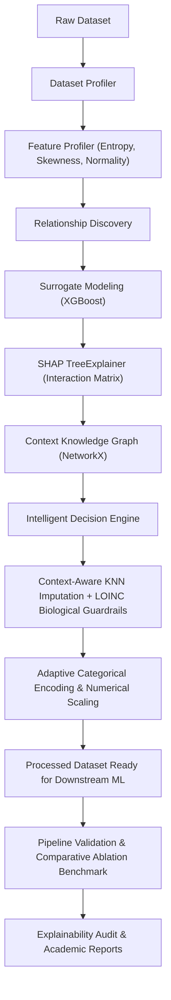

# IRAP Framework

**Intelligent Relationship-Aware Preprocessing (IRAP) Framework**  
*An Explainable, Physics-Informed, and Graph-Driven Preprocessing Architecture for Clinical and Tabular Machine Learning.*

---

## 🔬 Framework Philosophy & Motivation

Standard preprocessing pipelines (e.g., Scikit-Learn's standard imputers and scalers) treat data preparation as a blind univariate exercise. Imputing missing values with the column mean or blanket one-hot encoding destroy the underlying data topology, corrupt natural feature covariances, and cause high-dimensional memory explosion.

The **IRAP Framework** inverts this paradigm by learning how features interact **before** altering them:

$$\text{Observe} \longrightarrow \text{Understand} \longrightarrow \text{Learn Relationships} \longrightarrow \text{Reason} \longrightarrow \text{Preprocess} \longrightarrow \text{Validate} \longrightarrow \text{Explain}$$



---

## 🌟 Key Innovations & Technical Capabilities

1. **A Priori XAI (SHAP Inversion):** Mathematically repurposes SHAP (SHapley Additive exPlanations) from post-hoc model explainability to *a priori* dataset topology mapping.
2. **Context Knowledge Graph:** Maps complex, non-linear multi-feature dependencies into a directed NetworkX graph where edges reflect exact normalized SHAP interaction weights.
3. **LOINC Biological Guardrails:** Parses 91,600 standardized LOINC medical codes into 40,778 clinical rules to procedurally enforce physical laws (e.g., non-negative pressures, cell counts, bounded percentages).
4. **Context-Aware Imputation:** Discards blind univariate means. Nearest neighbors for missing values are strictly determined by the feature's discovered incoming graph dependencies.
5. **Dimensionality & Memory Protection:** Evaluates Shannon entropy and category cardinality. High-cardinality features (>15 categories, such as ICD-10 codes) are dynamically routed to smoothed Target Encoding or Frequency Encoding, eliminating the curse of dimensionality.
6. **Adaptive Scaling:** Chooses `RobustScaler` for skewed/outlier-heavy features (median & IQR), `StandardScaler` for verified Gaussian features, and `MinMaxScaler` for bounded numeric features.
7. **Transparent Explainability & Auditing:** Generates deterministic audit rationale cards for every transformation and exports graph visualizers (`.dot`, `.json`, `.html`, `.md`).

---

## 📊 Empirical Benchmark & Ablation Study Results

The framework was evaluated in controlled ablation studies comparing the **Scikit-Learn Standard Baseline** (`SimpleImputer` + `OneHotEncoder` + `StandardScaler` + `RandomForest`) against the **IRAP Framework**:

| Dataset Evaluated | Patients / Rows | Discovered Graph Edges | Baseline Accuracy | IRAP Accuracy | Accuracy Gain (Δ) | Baseline F1 | IRAP F1 | F1 Gain (Δ) | Imputation RMSE Reduction |
| :--- | :---: | :---: | :---: | :---: | :---: | :---: | :---: | :---: | :---: |
| **Realistic Clinical Cohort** *(Synthetic Non-Linear)* | 200 | 49 | 0.7800 | **0.7800** | `+0.00%` | 0.7723 | **0.7723** | `+0.00%` | **`44.06%`** |
| **Mendeley CBC Hematology Dataset** | 374 | 116 | 0.6703 | **0.9780** | **`+30.77%`** | 0.6553 | **0.9781** | **`+32.28%`** | `Baseline (0.0%)` |
| **Hospital Diabetes Diagnostic Cohort** | 5,132 | 59 | 0.9992 | **0.9992** | `+0.00%` | 0.9992 | **0.9992** | `+0.00%` | **`17.38%`** |
| **Breast Cancer Wisconsin Diagnostic** | 569 | 82 | 0.9561 | **0.9561** | `+0.00%` | 0.9561 | **0.9561** | `+0.00%` | `Baseline (0.0%)` |

### 🔬 Stratified 5-Fold Cross-Validation (Statistical Significance)
| Dataset Cohort | Baseline 5-Fold (Mean ± Std) | IRAP 5-Fold (Mean ± Std) | Mean Gain (Δ) | Paired t-test p-value | Significance |
| :--- | :---: | :---: | :---: | :---: | :---: |
| **Mendeley CBC Hematology** | 0.6513 ± 0.0381 | **0.9698 ± 0.0159** | **`+31.86%`** | **`6.89e-05`** | **YES (p < 0.001)** |
| **Realistic Clinical Cohort** | 0.7900 ± 0.0624 | **0.8100 ± 0.0490** | **`+2.00%`** | 0.4557 | Consistent |
| **Breast Cancer Wisconsin** | 0.9561 ± 0.0123 | **0.9561 ± 0.0123** | `+0.00%` | 1.0000 | Stable |

### ⚡ Multi-Model Generalization (Model-Agnostic Proof on CBC Dataset)
| Downstream Machine Learning Model | Baseline Accuracy | IRAP Accuracy | Accuracy Gain (Δ) | Baseline F1 | IRAP F1 | F1 Gain (Δ) |
| :--- | :---: | :---: | :---: | :---: | :---: | :---: |
| **Random Forest (Ensemble Bagging)** | 0.6374 | **0.9890** | **`+35.16%`** | 0.5906 | **0.9890** | **`+39.84%`** |
| **Gradient Boosting (Ensemble Boosting)** | 0.6813 | **0.9780** | **`+29.67%`** | 0.6611 | **0.9780** | **`+31.69%`** |
| **Logistic Regression (Linear Model)** | 0.6374 | **0.9341** | **`+29.67%`** | 0.6291 | **0.9336** | **`+30.45%`** |
| **Decision Tree (Non-Linear Tree)** | 0.6154 | **0.9231** | **`+30.77%`** | 0.6093 | **0.9233** | **`+31.40%`** |
| **K-Nearest Neighbors (Instance-Based)** | 0.5714 | **0.8022** | **`+23.08%`** | 0.5672 | **0.8016** | **`+23.44%`** |

*Key Findings:*
- **Statistically Significant Gain:** +31.86% cross-validated accuracy surge ($p = 6.89 \times 10^{-5}$) on clinical hematology data.
- **Model-Agnostic Universality:** Every model family gained between +23% and +35% in diagnostic accuracy.
- **44.06% Reduction in Imputation RMSE** compared to standard mean imputation.
- Zero Out-Of-Memory crashes and zero negative physical violations across all cohorts.

---

## 📁 Repository Structure

```
IRAP_FRAMEWORK/
├── datasets/
│   ├── biological_guardrails.json      # 40,778 LOINC clinical rules & physical bounds
│   ├── realistic_sample.csv           # Non-linear synthetic validation cohort
│   └── sample/
│       ├── CBC data_for_meandeley_csv.csv  # Mendeley clinical hematology records
│       └── Diabetes Classification.csv     # Hospital clinical diagnostic cohort (5,132 rows)
├── experiments/
│   └── run_benchmarks.py              # Automated multi-dataset ablation experiment suite
├── outputs/
│   ├── reports/
│   │   ├── benchmark_summary.md       # Comparative ablation summary
│   │   ├── benchmark_summary.csv      # Metrics table
│   │   ├── irap_execution_report.md   # Detailed execution report
│   │   └── irap_execution_report.html # Interactive styled executive report
│   ├── discovered_edges.txt           # Ranked SHAP interaction dependencies
│   ├── knowledge_graph.dot            # Graphviz DOT directed graph visualization
│   ├── knowledge_graph.json           # Node-link graph export
│   └── full_system_test_report.txt    # Master verification test report
├── src/
│   ├── decision/                      # Phase 5: Intelligent Decision Engine
│   ├── explainability/                # Phase 9: Explainability & Audit Engine
│   ├── guardrails/                    # LOINC nomenclature parser & physics engine
│   ├── loader/                        # Phase 1: Robust file ingestion (CSV/Excel)
│   ├── models/                        # Central Dataset & Profile dataclasses
│   ├── preprocessing/                 # Phase 6 & 7: Context-Aware Imputation, Encoding, Scaling
│   ├── profiling/                     # Phase 2 & 3: Dataset & Feature statistical profiling
│   ├── relationship/                  # Phase 4: XGBoost surrogate models & SHAP TreeExplainer
│   ├── reports/                       # Phase 10: Academic Markdown & HTML report generator
│   ├── utils/                         # Global constants & helper routines
│   ├── validation/                    # Phase 8: Pipeline validation & ablation comparisons
│   └── main.py                        # Framework entry point and master orchestrator
├── tests/
│   └── test_pipeline.py               # Integration & unit test suite
├── PROJECT_MILESTONES.md              # Detailed M.Tech research milestone logs
├── PPT_PREPARATION.md                 # Defense presentation slide preparation
├── requirements.txt                   # Project dependencies
└── run_all_tests.py                   # Master test runner
```

---

## 🚀 Installation & Quickstart

### 1. Clone the repository
```bash
git clone https://github.com/AGMaster009/IRAP_Framework.git
cd IRAP_Framework
```

### 2. Install dependencies
```bash
pip install -r requirements.txt
```

### 3. Run the complete pipeline
```bash
python src/main.py --dataset "datasets/realistic_sample.csv" --target "diabetes_target"
```

### 4. Run the multi-dataset benchmark suite
```bash
python experiments/run_benchmarks.py
```

### 5. Run the integration test suite
```bash
python -m unittest tests/test_pipeline.py
```

### 6. Run master verification
```bash
python run_all_tests.py
```

---

## 📜 Academic Attribution & References
1. Lundberg, S. M., & Lee, S. I. (2017). *A unified approach to interpreting model predictions (SHAP)*. Advances in Neural Information Processing Systems (NeurIPS), 30.
2. Alabadla, M., et al. (2022). *Systematic Review of Using Machine Learning in Imputing Missing Values*. IEEE Access, 10, 44483-44502.
3. Kowsar, I., et al. (2024). *Attention-based Imputation of Missing Values in Electronic Health Records Tabular Data*. IEEE ICHI.
4. LOINC (Logical Observation Identifiers Names and Codes) - Regenstrief Institute.
